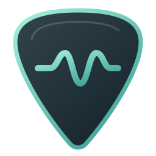
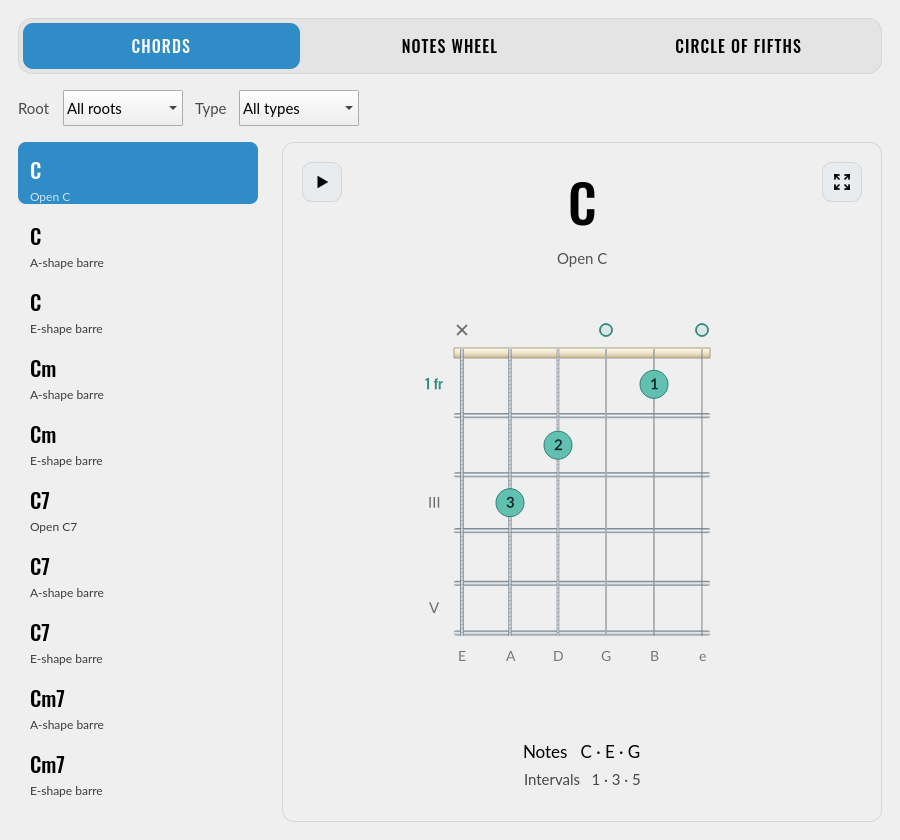

# Fretwave



A native Qt6 / KDE Kirigami guitar chord browser written in C++ and QML, with offline plucked-string audio. The upper-left corner of the chord panel plays/stops sound; the upper-right corner toggles focus mode. Includes a custom scalable guitar-pick icon for the app window and desktop launcher.



## Features

- 166 fingerings: 22 open shapes and 144 movable E-, A-, and D-shape barre voicings.
- All 12 roots, with major, minor, dominant seventh, minor seventh, sus2, and sus4 qualities.
- “Focus chord” hides filters and the chord list and enlarges the diagram. Use “Show browser” or Escape to return without losing your selection.
- Root and quality filters, alternate fingerings, finger numbers and barre diagrams.
- Chord-tone names and interval formulas. Hover over Intervals to see each note, interval name and semitone distance from the root.
- Hover over any string within a displayed fret to see its note and octave. Open/muted symbols show open-string pitches and distinguish strings muted in the selected chord.
- System palette support, keyboard-accessible controls and accessible diagram descriptions.
- Bundled Oswald display lettering and Lato body text, with Noto Sans available for symbol fallback. All fonts use the SIL Open Font License; see `fonts/Oswald-OFL.txt`, `fonts/Lato-OFL.txt`, and `fonts/OFL.txt`. Font sources: https://github.com/google/fonts/tree/main/ofl/oswald and https://github.com/google/fonts/tree/main/ofl/lato.
- Offline plucked-string synthesis: click any string/fret or open marker to hear its note. Play chord sounds the current fingering with a gentle strum, excluding muted strings. Playback uses a moderate default level; adjust loudness with your system volume. A new sound replaces the previous sound, and Stop sound cuts playback.
- Entirely offline, with no accounts or network services.

## Build and run

Requires a C++17 compiler, CMake 3.21+, Qt 6.5+ development packages (Core, Gui, Widgets, Qml, Quick, QuickControls2 and Multimedia), and KDE Frameworks 6 Kirigami development and QML runtime packages. The KDE desktop Qt Quick Controls style and Breeze icons are recommended on Plasma. Distribution package names vary.

From this folder:

```sh
cmake -S . -B build -DCMAKE_BUILD_TYPE=Release
cmake --build build --parallel
ctest --test-dir build --output-on-failure
./build/fretwave
```

Optional user-local installation:

```sh
cmake --install build --prefix "$HOME/.local"
```

Ensure `~/.local/bin` is in your desktop session's PATH so the application launcher can find the executable. The installation includes a desktop entry.

## Reading the diagrams

Strings run from low E on the left to high e on the right in standard E–A–D–G–B–e tuning. A circle means open and a cross means muted. Numbers are fingers: 1 index, 2 middle, 3 ring, 4 little. A thick connecting line shows a barre. The fret label identifies the first displayed fret.

The notes line describes the complete chord formula. A voicing may omit its fifth (for example open C7). Fingerings are suggestions; comfortable fingering can vary by player.

## Current scope

Three tabs: Chords, a chromatic Notes wheel, and the Circle of fifths. Both wheels let you select a root and optionally highlight major or minor chord tones. The chord browser has root and type filters, a list sorted by root and chord type, and an always-visible fingering diagram. All 166 fingerings are shown when the filters are set to “All”. Uses right-handed diagrams and standard tuning. No quiz, accounts, or saved progress. Audio uses a lightweight synth rather than guitar recordings. Higher barre shapes can reach fret 15.

## Verification

The audio-synthesis test checks chord voicings, muted strings, pitch, decay, and clipping at 44.1/48 kHz. `--audio-test` checks live output, retriggering, mute and stop.

The chord-integrity test checks all voicings against their expected pitch classes, permits omission of the fifth in seventh chords, validates finger numbers and diagram bounds, and checks coverage and filtering for all 72 root/type combinations. The UI workflow check runs offscreen and checks filtering, full-library count, chord selection, tab switching, both wheel orders and minor chord tones. The application also supports `--smoke-test` and `--screenshot path.png` for visual inspection.

## License

Copyright © 2026 Mauro Codella.

Fretwave source code and original artwork are licensed under **GPL-3.0-only**. See [LICENSE](LICENSE).
Bundled fonts retain their separate SIL Open Font License terms. See [THIRD_PARTY_NOTICES.md](THIRD_PARTY_NOTICES.md) for font notices and dependency information.

## Releases and Arch Linux

Successful pushes to `main` automatically publish a tested release with a source
archive and an x86_64 Arch Linux package. Download them from
[GitHub Releases](https://github.com/codella/fretwave/releases).

See [release automation](docs/releases.md) for details.
